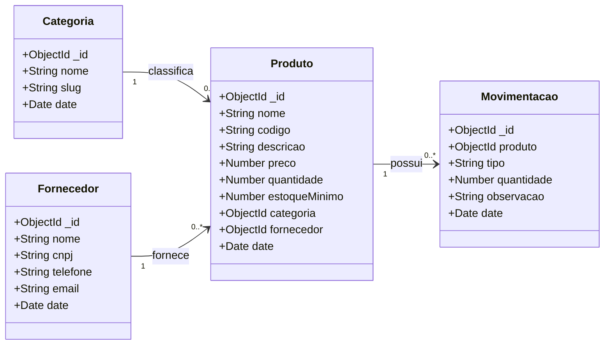
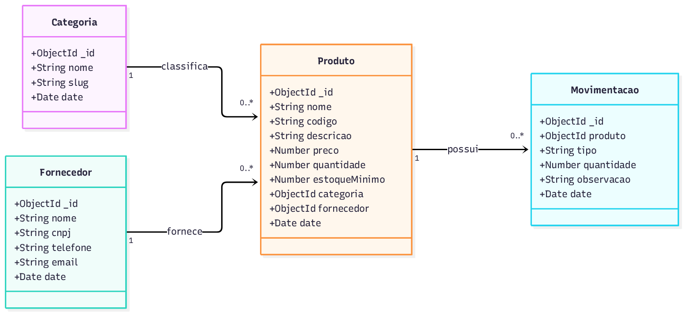
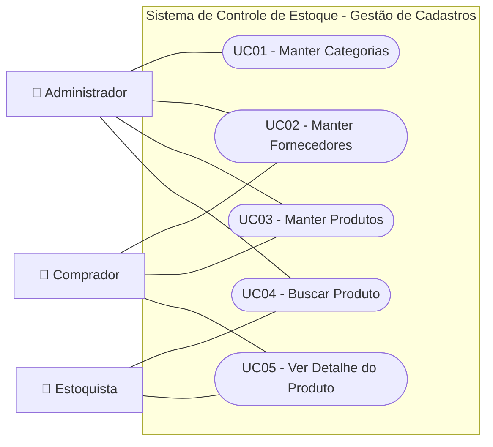
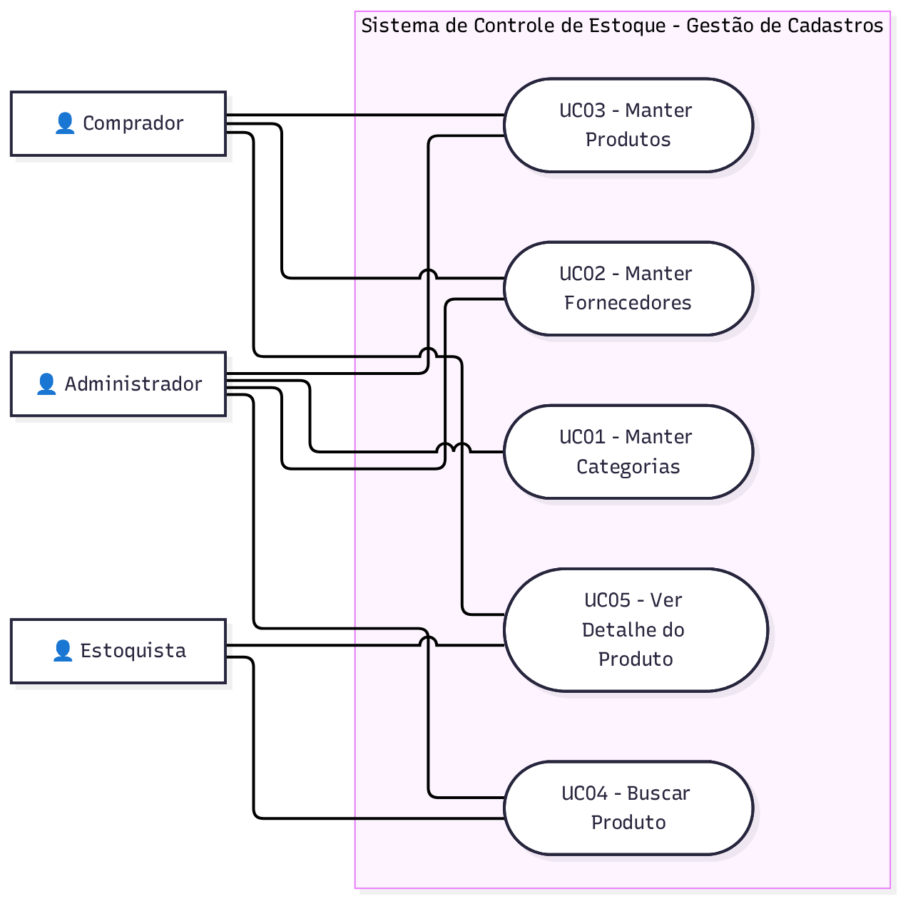
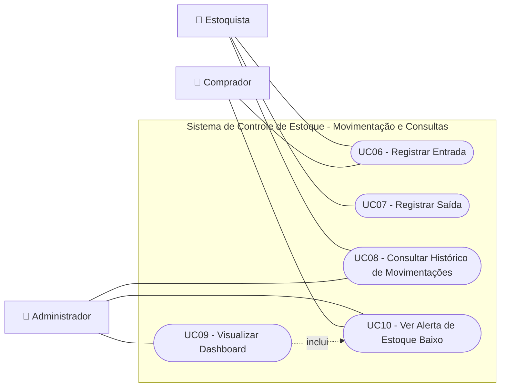
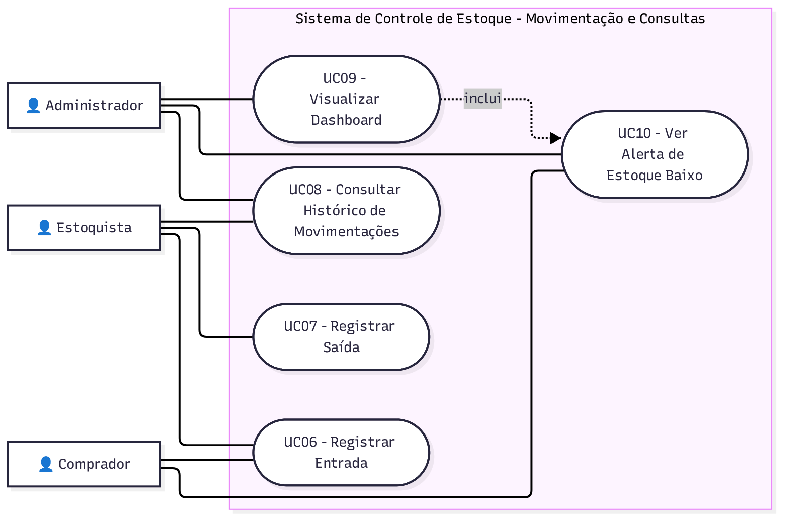

# Modelagem de Dados

O banco é o **MongoDB** (banco `estoque`) e cada classe abaixo é um **Schema do Mongoose** (pasta `models/`), salvo em uma coleção. Os relacionamentos são feitos guardando o `_id` do documento relacionado (`ObjectId` com `ref`), e o `populate()` busca o documento completo na hora da consulta.

---

## 1. Diagrama de classes

### Descrição das classes

**Categoria** (coleção `categorias`) — Agrupa os produtos por tipo (ex.: Bebidas, Limpeza).
- `nome` (String, obrigatório): nome exibido da categoria.
- `slug` (String, obrigatório): versão do nome para uso em URL, sem espaços (ex.: `higiene-pessoal`).
- `date` (Date, padrão `Date.now`): data de cadastro, usada para ordenar as listagens.

**Fornecedor** (coleção `fornecedores`) — Empresa que vende os produtos para a loja.
- `nome` (String, obrigatório), `cnpj`, `telefone`, `email` (String, opcionais), `date` (Date).

**Produto** (coleção `produtos`) — Item controlado no estoque.
- `nome` (String, obrigatório).
- `codigo` (String, obrigatório, **único**): SKU do produto; o sistema não deixa repetir.
- `descricao` (String, opcional).
- `preco` (Number, obrigatório, mínimo 0).
- `quantidade` (Number, padrão 0, mínimo 0): estoque atual. É informada só no cadastro; depois muda **apenas** pelas movimentações.
- `estoqueMinimo` (Number, padrão 5): abaixo ou igual a esse valor o produto entra no alerta de estoque baixo.
- `categoria` (ObjectId → `categorias`, obrigatório) e `fornecedor` (ObjectId → `fornecedores`, obrigatório).
- `date` (Date).

**Movimentacao** (coleção `movimentacoes`) — Registro de cada entrada ou saída de mercadoria.
- `produto` (ObjectId → `produtos`, obrigatório).
- `tipo` (String, obrigatório): `"entrada"` ou `"saida"`.
- `quantidade` (Number, obrigatório, maior que zero).
- `observacao` (String, opcional): ex.: "compra NF 123", "venda balcão".
- `date` (Date): data/hora da movimentação.

### Descrição dos relacionamentos

| Relacionamento | Cardinalidade | Descrição |
|---|---|---|
| Categoria → Produto | 1 para 0..N | Uma categoria classifica vários produtos; cada produto pertence a exatamente uma categoria. Uma categoria com produtos **não pode ser excluída**. |
| Fornecedor → Produto | 1 para 0..N | Um fornecedor fornece vários produtos; cada produto tem exatamente um fornecedor. Um fornecedor com produtos **não pode ser excluído**. |
| Produto → Movimentacao | 1 para 0..N | Um produto tem várias movimentações (seu histórico); cada movimentação é de um único produto. Ao excluir um produto, as movimentações dele também são excluídas. |

---

## 2. Diagramas de casos de uso

> O Mermaid não tem diagrama de casos de uso nativo; por isso foi usado um `flowchart LR` com os atores à esquerda e os casos de uso (elipses) dentro do retângulo do sistema.

### (a) Gestão de Cadastros

#### UC01 — Manter Categorias
- **Ator:** Administrador
- **Objetivo:** cadastrar, listar, editar e excluir categorias de produtos.
- **Pré-condição:** sistema em execução e conectado ao banco.
- **Fluxo principal:** 1) Acessa "Categorias". 2) Clica em "Nova categoria". 3) Informa nome e slug. 4) Clica em "Criar categoria". 5) O sistema salva e mostra "Categoria criada com sucesso!" na lista. Para editar, clica em "Editar", altera e salva; para excluir, clica em "Deletar" e confirma.
- **Fluxo alternativo/erro:** campos vazios ou nome com menos de 2 caracteres → a tela é exibida de novo com os erros em vermelho. Exclusão de categoria com produtos → mensagem "Não é possível deletar: existem N produto(s) nesta categoria".

#### UC02 — Manter Fornecedores
- **Ator:** Administrador, Comprador
- **Objetivo:** manter o cadastro de fornecedores (nome, CNPJ, telefone, e-mail).
- **Pré-condição:** sistema em execução.
- **Fluxo principal:** 1) Acessa "Fornecedores". 2) Clica em "Novo fornecedor". 3) Preenche os dados. 4) Salva. 5) O fornecedor aparece na tabela com mensagem de sucesso. Edição e exclusão como no UC01.
- **Fluxo alternativo/erro:** nome vazio/curto ou e-mail sem "@" → erros exibidos no formulário. Exclusão de fornecedor com produtos → bloqueada com mensagem de erro.

#### UC03 — Manter Produtos
- **Ator:** Administrador, Comprador
- **Objetivo:** cadastrar, editar e excluir produtos do estoque.
- **Pré-condição:** existir pelo menos uma categoria e um fornecedor cadastrados.
- **Fluxo principal:** 1) Acessa "Produtos" → "Novo produto". 2) Informa nome, código, descrição, preço, quantidade inicial, estoque mínimo, categoria e fornecedor. 3) Salva. 4) O produto aparece na lista. Na edição, a quantidade aparece bloqueada (só muda por movimentação). Na exclusão, o produto e seu histórico são removidos após confirmação.
- **Fluxo alternativo/erro:** campos obrigatórios vazios, preço negativo/não numérico, quantidade negativa ou categoria/fornecedor não selecionados → erros no formulário, com os dados digitados mantidos. Código já existente → "Já existe um produto com o código X".

#### UC04 — Buscar Produto
- **Ator:** Estoquista, Administrador
- **Objetivo:** encontrar rapidamente um produto pelo nome ou código.
- **Pré-condição:** existir produtos cadastrados.
- **Fluxo principal:** 1) Na lista de produtos, digita parte do nome ou do código no campo de busca. 2) Clica em "Buscar". 3) O sistema mostra apenas os produtos que combinam (sem diferenciar maiúsculas/minúsculas).
- **Fluxo alternativo/erro:** nenhum produto encontrado → "Nenhum produto encontrado." O botão "Limpar" volta à lista completa.

#### UC05 — Ver Detalhe do Produto
- **Ator:** Estoquista, Comprador
- **Objetivo:** ver todos os dados de um produto e seu histórico de movimentações.
- **Pré-condição:** o produto existir.
- **Fluxo principal:** 1) Clica no nome do produto na lista. 2) O sistema mostra código, descrição, categoria, fornecedor, preço, estoque atual e mínimo, e a tabela de movimentações do produto. 3) Pode ir direto para "Registrar movimentação" ou "Editar".
- **Fluxo alternativo/erro:** produto inexistente (id inválido) → volta para a lista com "Este produto não existe".

### (b) Movimentação de Estoque e Consultas

#### UC06 — Registrar Entrada
- **Ator:** Estoquista, Comprador
- **Objetivo:** dar entrada em mercadoria recebida, aumentando o estoque.
- **Pré-condição:** o produto estar cadastrado.
- **Fluxo principal:** 1) Acessa "Movimentações" → "Nova movimentação". 2) Escolhe o produto, marca "Entrada", informa a quantidade e uma observação. 3) Clica em "Registrar". 4) O sistema soma a quantidade ao estoque do produto, salva a movimentação e mostra "Movimentação registrada! Estoque atual de X: N".
- **Fluxo alternativo/erro:** produto não selecionado ou quantidade vazia, zero, negativa ou não inteira → erros exibidos no formulário, nada é salvo.

#### UC07 — Registrar Saída
- **Ator:** Estoquista
- **Objetivo:** registrar a saída de mercadoria (venda, perda, uso interno), diminuindo o estoque.
- **Pré-condição:** o produto estar cadastrado e ter estoque.
- **Fluxo principal:** igual ao UC06, marcando "Saída"; o sistema subtrai a quantidade do estoque.
- **Fluxo alternativo/erro:** **quantidade maior que o estoque disponível** → o sistema bloqueia e mostra "Estoque insuficiente: X tem apenas N unidade(s)", sem alterar o produto nem gravar a movimentação. Demais validações como no UC06.

#### UC08 — Consultar Histórico de Movimentações
- **Ator:** Estoquista, Administrador
- **Objetivo:** ver todas as entradas e saídas registradas.
- **Pré-condição:** nenhuma.
- **Fluxo principal:** 1) Acessa "Movimentações". 2) O sistema lista data, produto, tipo (badge verde para entrada, amarela para saída), quantidade e observação, das mais recentes para as mais antigas.
- **Fluxo alternativo/erro:** sem registros → "Nenhuma movimentação registrada."

#### UC09 — Visualizar Dashboard
- **Ator:** Administrador
- **Objetivo:** ter uma visão geral do estoque em uma única tela.
- **Pré-condição:** nenhuma.
- **Fluxo principal:** 1) Acessa "Início". 2) O sistema mostra os totais de produtos, categorias, fornecedores, o valor total em estoque (soma de preço × quantidade), a lista de estoque baixo (inclui o UC10) e as 5 últimas movimentações.
- **Fluxo alternativo/erro:** falha ao consultar o banco → mensagem "Houve um erro ao carregar o dashboard".

#### UC10 — Ver Alerta de Estoque Baixo
- **Ator:** Administrador, Comprador
- **Objetivo:** identificar produtos que precisam de reposição.
- **Pré-condição:** existir produtos com quantidade menor ou igual ao estoque mínimo.
- **Fluxo principal:** 1) No dashboard, o card vermelho "Estoque baixo" lista esses produtos com a quantidade atual e o mínimo. 2) Na lista de produtos, as linhas desses itens recebem o destaque "Estoque baixo".
- **Fluxo alternativo/erro:** nenhum produto abaixo do mínimo → "Nenhum produto com estoque baixo."
